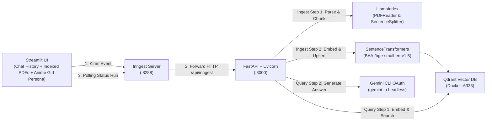

# Product Requirements Document (PRD) — RAGMON

> **Status:** Approved (Curated)  
> **Lokasi Proyek:** `/Users/mac/Documents/Codes/AI-Engineer-Projects/RAGMON`  
> **Referensi Utama:** Production-Ready RAG AI Agent in Python (Inngest + Qdrant + FastAPI + LlamaIndex + Gemini CLI OAuth + SentenceTransformers + Streamlit)

---

## 1. Ringkasan Eksekutif & Tujuan Produk

### 1.1 Latar Belakang Masalah
Sebagian besar proyek *Retrieval-Augmented Generation* (RAG) tingkat pemula hanya berjalan secara sinkron dalam satu skrip sederhana. Pendekatan tersebut tidak siap untuk lingkungan produksi (*production*) karena:
- Tidak memiliki *observability* (sulit melacak langkah mana yang lambat atau gagal).
- Tidak memiliki mekanisme *retry* otomatis per langkah ketika proses eksternal mengalami gangguan.
- Rentan terhadap lonjakan trafik dan pemborosan resource karena tidak adanya *rate limiting*, *throttling*, dan *concurrency control*.

### 1.2 Tujuan Produk
**RAGMON** adalah aplikasi tanya-jawab dokumen PDF berbasis AI (*PDF RAG Agent*) berarsitektur *event-driven* dan *durable execution*. Pengguna dapat mengunggah dokumen PDF, melihat daftar PDF yang sudah terindeks, dan berinteraksi melalui antarmuka chat ber-riwayat (*chat history*) dengan asisten AI berpersona **Anime Girl** yang ceria dan menyenangkan—yang menjawab pertanyaan secara akurat berdasarkan isi dokumen beserta sitasi sumbernya.

---

## 2. Ruang Lingkup (Scope)

### 2.1 In-Scope (MVP + Fitur Kurasi)
- Unggah dokumen PDF melalui antarmuka web (**Streamlit**).
- Ekstraksi teks PDF dan pemecahan teks (*chunking*) dengan *overlap* (**LlamaIndex**).
- Pembuatan vektor embedding secara lokal tanpa API key tambahan (**SentenceTransformers**) dan generasi jawaban menggunakan **Gemini CLI OAuth** (`gemini -p` headless mode).
- Penyimpanan dan pencarian kemiripan vektor (**Qdrant** via Docker, dengan fallback mode lokal jika Docker belum menyala).
- Orkestrasi *event-driven* dengan *step checkpoints*, *auto-retry*, logging, dan *flow control* (**Inngest** + **FastAPI**).
- Antarmuka chat interaktif dengan:
  - **Riwayat Chat (*Chat History*)** dalam sesi pengguna.
  - **Daftar PDF Terindeks (*Indexed PDFs*)** yang menampilkan dokumen yang sudah masuk ke Qdrant.
  - **Persona Asisten Anime Girl** yang fun, ekspresif, namun tetap setia pada fakta dokumen (*strict context grounding*) dan menyertakan sitasi sumber.

### 2.2 Out-of-Scope (Untuk Pengembangan Lanjutan)
- Autentikasi pengguna (*login/multi-tenant*).
- Dukungan format dokumen selain PDF (`.docx`, `.csv`, halaman web).
- Deployment ke cloud publik (fokus awal adalah lingkungan lokal yang siap dideploy).

---

## 3. Arsitektur Sistem & Tech Stack

### 3.1 Alur Arsitektur


### 3.2 Tech Stack
| Komponen | Teknologi | Peran & Spesifikasi |
|---|---|---|
| **Bahasa & Package Manager** | Python 3.11+ & `uv` | Manajemen environment, dependensi (`pyproject.toml`), dan eksekusi script |
| **Backend API & Server** | FastAPI & Uvicorn | Menyajikan endpoint `/api/inngest` pada port `8000` |
| **Orkestrasi & Observability** | Inngest (`inngest` SDK + `inngest-cli`) | *Event-driven workflow*, *step checkpointing*, *auto-retry*, *flow control*, Dev UI (`:8288`) |
| **Vector Database** | Qdrant (`qdrant-client` + Docker) | Penyimpanan & *cosine similarity search* vektor berdimensi `384` (`:6333`) |
| **PDF Parsing & Chunking** | LlamaIndex (`PDFReader`, `SentenceSplitter`) | Ekstraksi teks PDF & pemecahan chunk (`chunk_size=1000`, `chunk_overlap=200`) |
| **Embedding Model** | SentenceTransformers (`BAAI/bge-small-en-v1.5`) | Embedding lokal cepat (384-d) tanpa membutuhkan API key tambahan |
| **LLM (Generation)** | Gemini CLI OAuth (`gemini -p`) | Generasi jawaban dengan persona Anime Girl menggunakan akun OAuth Gemini CLI |
| **Validasi & Serialisasi** | Pydantic | Model data *type-safe* & `inngest.PydanticSerializer` antar-step |
| **Frontend UI** | Streamlit | Chat UI ber-riwayat, daftar PDF terindeks, upload PDF, kontrol `top_k` |
| **Konfigurasi** | `python-dotenv` | Memuat konfigurasi lokal dari `.env` |

---

## 4. Persyaratan Fungsional (Functional Requirements)

### FR-1: PDF Ingestion Pipeline (`rag/ingest_pdf`)
1. Menerima event `rag/ingest_pdf` dengan payload `pdf_path` dan opsional `source_id`.
2. **Step 1 (`load-and-chunk`):** Ekstraksi teks via `PDFReader`, lalu dipecah dengan `SentenceSplitter(chunk_size=1000, chunk_overlap=200)`.
3. **Step 2 (`embed-and-upsert`):** Membuat embedding via `SentenceTransformers`, menghasilkan ID deterministik `uuid5(NAMESPACE_URL, f"{source_id}:{index}")`, dan melakukan *upsert* ke Qdrant collection `documents` dengan payload `{"source": source_id, "text": chunk}`.

### FR-2: RAG Query & Answering Pipeline (`rag/query_pdf_ai`)
1. Menerima event `rag/query_pdf_ai` dengan payload `question`, `top_k` (default `5`), dan opsional `chat_history` singkat untuk kesinambungan percakapan.
2. **Step 1 (`embed-and-search`):** Meng-embed `question` dan mengambil `top_k` potongan paling relevan + daftar `sources` yang dideduplikasi.
3. **Step 2 (`answer`):** Memanggil Gemini CLI (`gemini -p`) dengan *system/persona prompt* **Anime Girl Assistant** yang ceria, suportif, dan fun, namun **wajib menjawab hanya berdasarkan konteks dokumen** yang ditemukan.

### FR-3: Frontend Antarmuka Pengguna (`streamlit_app.py`)
1. **Sidebar:**
   - Upload PDF (`st.file_uploader`) + tombol proses ingest.
   - **Daftar PDF Terindeks:** Mengambil daftar `source` unik langsung dari Qdrant agar pengguna tahu dokumen apa saja yang siap ditanyakan.
   - Pengaturan `top_k` dan tombol *Clear Chat History*.
2. **Main Chat Area:**
   - Tampilan *chat bubble* (`st.chat_message`) dengan avatar & gaya bicara **Anime Girl** beserta *chat history* (`st.session_state.messages`).
   - *Polling* status event Inngest secara asinkron dengan indikator loading yang sesuai tema.
   - Menampilkan sumber/sitasi dokumen di bawah jawaban asisten.

### FR-4: Flow Control & Proteksi Produksi (Inngest)
1. **Throttling**, **Concurrency**, dan **Rate Limiting** berbasis `source_id` (maksimal 1x ingest per 4 jam untuk dokumen yang sama).

---

## 5. Model Data & Skema

### 5.1 Pydantic Models (`custom_types.py`)
- `RAGChunkAndSrc`: `chunks: list[str]`, `source_id: str | None = None`
- `RAGUpsertResult`: `ingested: int`
- `RAGSearchResult`: `contexts: list[str]`, `sources: list[str]`
- `RAGQueryResult`: `answer: str`, `sources: list[str]`, `num_contexts: int`

### 5.2 Qdrant Collection (`documents`)
- **Vector Size:** `384` (menyesuaikan `BAAI/bge-small-en-v1.5`)
- **Distance Metric:** `COSINE`
- **Payload:** `{"source": "nama_file.pdf", "text": "..."}`

---

## 6. Struktur Direktori Proyek

```text
RAGMON/
├── .env.example          # Template environment variables
├── .gitignore            # Abaikan .env, .venv, __pycache__, uploads/, qdrant_storage/
├── PRD.md                # Dokumen PRD ini
├── pyproject.toml        # Konfigurasi proyek & dependensi uv
├── docker-compose.yml    # Konfigurasi container Qdrant lokal
├── custom_types.py       # Pydantic models
├── data_loader.py        # PDF loading, chunking, & SentenceTransformers embedding
├── vector_db.py          # Wrapper QdrantStorage (upsert, search, list_sources)
├── main.py               # FastAPI app & Inngest functions
└── streamlit_app.py      # Streamlit Chat UI (Anime Girl Assistant + Indexed PDFs)
```

---

## 7. Tahapan Implementasi (Milestones)

1. **Fase 1 — Setup Proyek & Infrastruktur:** Inisialisasi `uv`, instalasi dependensi, setup `.env.example`, `.gitignore`, `docker-compose.yml` (Qdrant).
2. **Fase 2 — Data & Vector Layer:** Implementasi `custom_types.py`, `vector_db.py`, dan `data_loader.py`.
3. **Fase 3 — Orkestrasi & Backend API:** Implementasi `main.py` (FastAPI + fungsi Inngest).
4. **Fase 4 — Frontend & Flow Control:** Implementasi `streamlit_app.py` (Chat History + Indexed PDFs + Anime Girl Persona) & flow control Inngest.
5. **Fase 5 — Verifikasi End-to-End:** Uji unggah PDF, cek vektor & daftar sumber, uji tanya-jawab di Streamlit dan pantau di Inngest UI.
